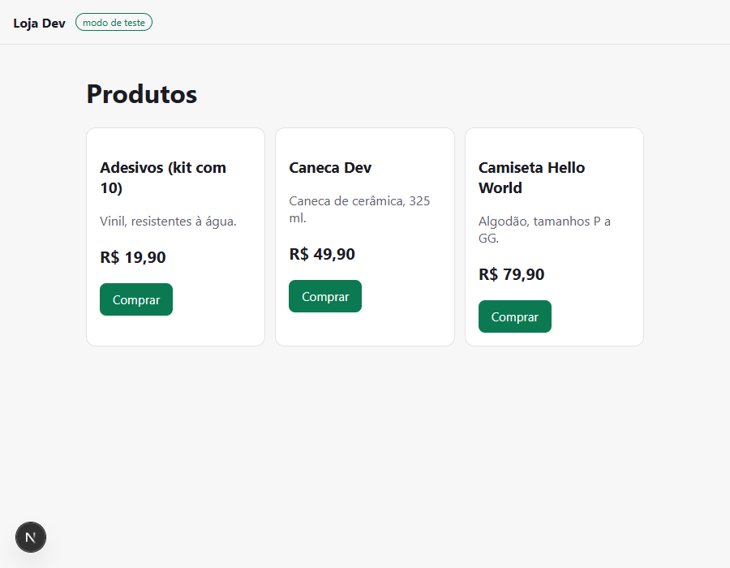
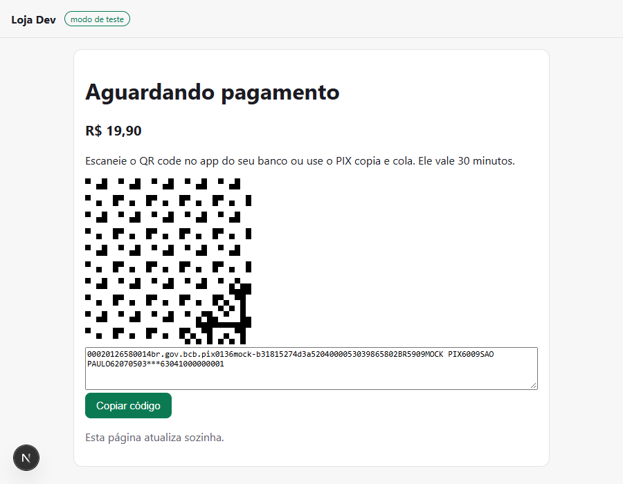
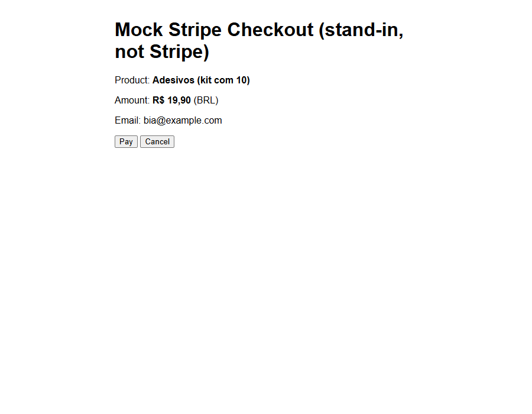
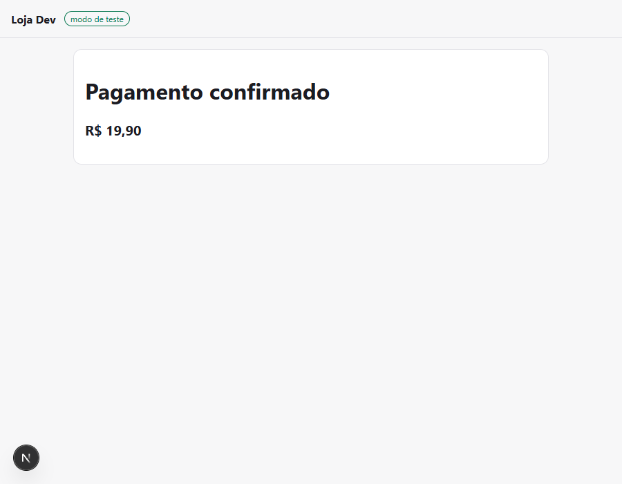

# 02 · PIX and Stripe checkout

A small shop where each order is paid by **PIX through Mercado Pago** or by
**card through Stripe Checkout**, built on Next.js 15 and Supabase. Everything
runs in sandbox or test mode.

| The product list | A PIX order, with the placeholder QR and copy-paste code |
|---|---|
|  |  |

| The card order's Checkout page (the local mock, not Stripe) | The order after the mock confirmed it |
|---|---|
|  |  |

These images are shot from the keyless run, so the PIX QR is a placeholder, the
Checkout page is the local mock and not Stripe's, and the payment was confirmed
by the mock's signed webhook. Nothing here comes from Mercado Pago or Stripe.

```
Produtos ─► Checkout (email + PIX or card) ─► POST /api/orders
                                                 │
                    ┌────────────────────────────┴───────────────────────────┐
                    ▼                                                        ▼
      Mercado Pago: PIX charge                                Stripe: Checkout Session
      QR code + copia e cola on /orders/:id                   redirect to Stripe's page
                    │                                                        │
                    ▼                                                        ▼
      POST /api/webhooks/mercadopago                          POST /api/webhooks/stripe
      verify x-signature, read status back from the API       verify stripe-signature
                    └──────────────► applyEvent ◄─────────────────────────────┘
                          record the event once, move the order if allowed
                                           │
                                           ▼
                        /orders/:id polls until paid, failed or expired
```

## What it gets right

- **The price comes from the database.** The browser sends only the product id,
  email and method.
- **Only a verified webhook marks an order paid.** The buyer returning to the
  success URL proves nothing.
  - **Mercado Pago:** the `x-signature` HMAC is checked, notifications older than
    five minutes are refused as replays, and the status is read back from the
    payments API rather than trusted from the request.
  - **Stripe:** the raw body is checked with `constructEvent`.
- **Each event is processed once.** `payment_events` has a primary key on
  `(provider, event_id)`, so a retried webhook is recorded once and skipped
  after that.
- **Late or out-of-order events cannot undo a payment.** `lib/orders.ts`
  allows only `pending → paid | failed | expired` and `paid → refunded`, and
  the update only lands if the status hasn't changed since it was read, so
  two events racing for one order cannot both apply.
- **No double charges.** The order id is the idempotency key for both providers.
- **A provider error fails the order** instead of leaving a pending order with
  nothing to pay.
- **The service-role key stays on the server.** RLS is on with no policies, so
  the public anon key can read nothing.

## Run it

Needs Node 20+, Docker (for local Supabase), a Mercado Pago test account and a
Stripe account in test mode.

```bash
npm install
npx supabase start          # local Postgres + API; prints the service_role key
npx supabase db reset       # applies the migration and seeds three products
cp .env.example .env.local  # then fill it in
npm run dev
```

Webhooks need to reach your machine:

- **Stripe:** `stripe listen --forward-to localhost:3000/api/webhooks/stripe`, and
  put the `whsec_...` it prints in `STRIPE_WEBHOOK_SECRET`.
- **Mercado Pago:** expose port 3000 with a tunnel (`cloudflared tunnel --url
  http://localhost:3000` or ngrok), set `APP_URL` to the tunnel's URL, and copy
  the webhook secret from your app's Webhooks page into `MP_WEBHOOK_SECRET`.

Test payments:

- **Card:** `4242 4242 4242 4242`, any future date and CVC. `4000 0000 0000 0002`
  is declined.
- **PIX:** use a Mercado Pago test buyer account. To approve the payment, follow
  the sandbox instructions on your app's page, since the test QR code cannot be
  paid from a real bank app.

`MP_API_BASE` and `STRIPE_API_BASE` stay unset for the real APIs; they exist
only for the keyless run below.

## Run it without any account (keyless)

Needs Node 20+ and Docker (for local Supabase), and no Mercado Pago or Stripe
account. A small local server stands in for both providers.

```bash
npm install
npx supabase start                           # local Postgres + API; prints the service_role key
npx supabase db reset                        # applies the migration and seeds three products
cp .env.keyless.example .env.local           # then add the service_role key
npm run mock                                 # terminal 1: the stand-in providers, on :4010
npm run dev                                  # terminal 2: the app, on :3000
```

To pay:

- **PIX:** the order page shows the code. The approve page is
  `http://localhost:4010/mp/pay/<payment id>`. The mock logs it when the order
  is created, as `mp payment <id> created: approve at
  http://localhost:4010/mp/pay/<id>`; the order page does not link it. Approve
  sends the signed webhook.
- **Card:** the order redirects to the mock's Checkout page, where Pay sends the
  signed webhook.

Then, with both keys from `npx supabase status -o env`:

```bash
SR_KEY=<SERVICE_ROLE_KEY> ANON_KEY=<ANON_KEY> npm run keyless-check
```

It prints one JSON object of `{ name, expected, actual }` rows and exits 1 if
any row differs.

What is mocked:

- **Mercado Pago:** no open-source stand-in exists, so the local mock creates
  PIX payments with a placeholder image that is not a scannable QR, and posts
  signed notifications.
- **Stripe:** stripe-mock was considered and not used. It is stateless with
  fixed responses and cannot complete a session or send webhooks, so the local
  mock answers Checkout Session create and sends signed events.
- **Supabase:** real, local and open source.

The app's own signature checks, idempotency and once-only processing run
unchanged against the mocks. Nothing in this run touches the real providers, and
a screenshot from it shows the stand-ins. With the keyless run up, `cd
scripts/screenshots && npm install && node shoot.mjs 02`, run from the repo
root, re-shoots the images at the top of this page.

## Tests

```bash
npm test          # 34 unit tests
npm run typecheck
npm run build
```

The tests cover what goes wrong in production:

- **Order transitions:** late, duplicate and out-of-order events.
- **Mercado Pago signatures:** wrong secret, a swapped payment id, replays,
  timestamps in milliseconds, lower-case ids, and missing or malformed headers.
- **Stripe events:** how each one maps to an order status.
- **Stripe signatures:** a signed payload is accepted and a tampered one refused.

Checked once by hand against a local Supabase, with dummy provider keys and
Stripe events signed with a test secret:

- The products load from the database.
- A request carrying its own price is charged the database price.
- A provider error marks the order failed and returns 502.
- A forged signature gets 400, and a repeated event is recorded once.
- A late `expired` event cannot undo `paid`, and a refund then applies.
- The anon key reads no orders.

The Mercado Pago webhook still needs a real sandbox payment to read back.

## Files

| Path | What it holds |
|---|---|
| `supabase/migrations/` | Tables, enums and RLS |
| `supabase/seed.sql` | Three demo products |
| `lib/orders.ts` | Status transitions, BRL formatting |
| `lib/mercadopago.ts` | PIX charge, payment lookup, status map, webhook signature |
| `lib/stripe.ts` | Checkout Session, event map |
| `lib/db.ts` | Supabase queries and `applyEvent` |
| `app/api/` | Order creation, order status, both webhooks |
| `app/` | Product list, checkout form, order page |
| `mocks/` | Local stand-in for Mercado Pago and Stripe Checkout, and its tests |
| `scripts/keyless-check.mjs` | End-to-end check of the keyless run |
| `.env.keyless.example` | Placeholder environment for the keyless run |
