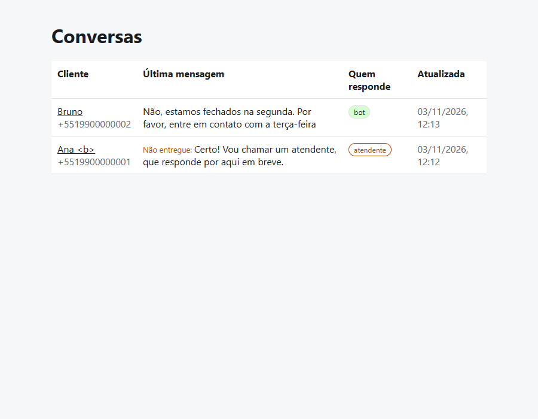
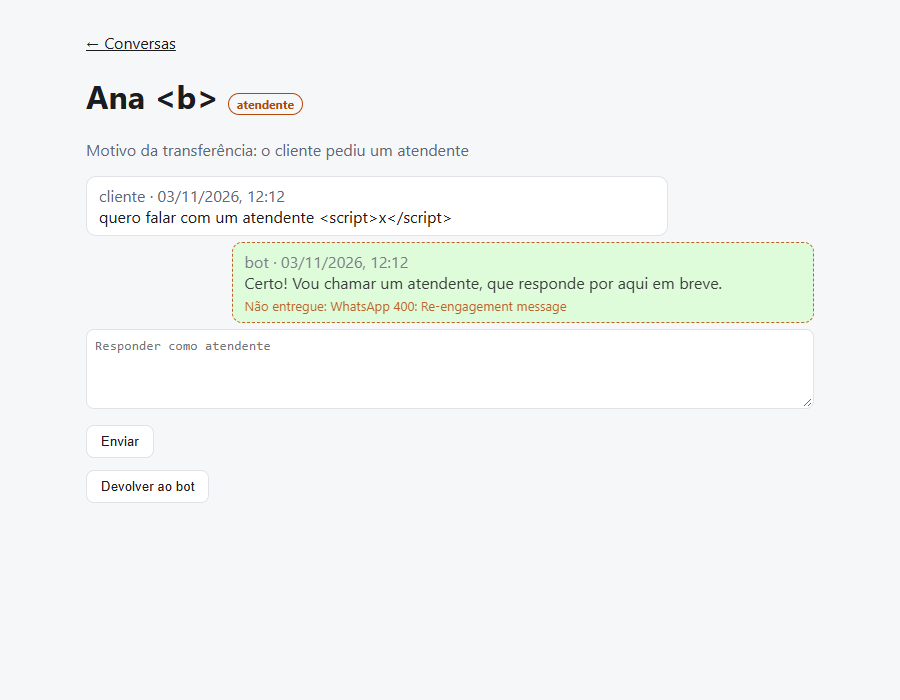
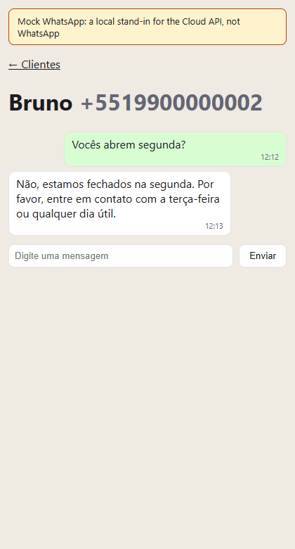

# 03 · WhatsApp AI support bot

A WhatsApp assistant for a small business, here a pizzeria, on the **official
WhatsApp Cloud API**. Claude answers questions from the business's own
information. When it can't answer, or the customer has a complaint or asks for
a person, it hands the conversation to an attendant, who replies from a small
dashboard. It runs two ways: with your own WhatsApp and Anthropic accounts, or
keyless, with a local mock of WhatsApp and a small local model.

| The dashboard | A conversation handed to an attendant |
|---|---|
|  |  |



The customer's side above is the local mock's chat page, not WhatsApp; the reply comes from the small local model.

```
Customer ─► WhatsApp ─► POST /webhook ─► check X-Hub-Signature-256
                                           │ 200 right away, work after
                                           ▼
                                 store message (once per wamid)
                                           │
              ┌──────── attendant owns it? ┼── asked for a person? ───► hand off
              │ stay quiet                 ▼
              │                      Claude + business info
              │                       │                  │
              │                 answer in text     handoff_to_human tool
              │                       ▼                  ▼
              └──────────────► reply via Cloud API, stored for /admin
```

## What it gets right

- **Official API only.** It uses no unofficial WhatsApp libraries (Baileys,
  Evolution, Z-API), which break WhatsApp's terms and get numbers banned.
- **Every webhook is authenticated.** `X-Hub-Signature-256` is checked against
  the app secret on the raw body before any JSON is read.
- **Each message is answered once.** The webhook acknowledges at once so Meta
  doesn't retry, and the WhatsApp message id is unique in the database, so a
  redelivered message is stored and answered once.
- **The bot answers only from `src/knowledge.md`.** The prompt forbids invented
  prices, hours or promises. Complaints, refunds, cancellations, large orders
  and unknown questions go to a person through a tool call, not a guess.
- **Handoff never depends on the model.** "Atendente", "humano", "gerente" or
  "falar com alguém" hand off without an API call. If the API fails, refuses or
  returns nothing, the customer is told an attendant is coming.
- **The 24-hour rule is respected.** WhatsApp allows free-form replies only
  within 24 hours of the customer's last message, so the dashboard refuses
  replies outside that window.
- **The dashboard is safe to expose.** It uses Basic auth, escapes every
  customer message, and refuses form posts from other sites.
- **Calls stay cheap.** The system prompt is cached, only the last 20 messages
  are sent, and effort is `low`, since short answers from a fixed text need no
  deep reasoning. If a safety classifier declines, the API retries on a fallback
  model within the same call.

## Run it

You need a Meta developer app with the WhatsApp product, which gives a free
test number, and an Anthropic API key.

```bash
cp .env.example .env    # fill it in
docker compose up --build
```

Or without Docker, keeping conversations in memory:

```bash
npm install
npm run dev
```

Then:

1. Expose port 3000 with a tunnel: `cloudflared tunnel --url http://localhost:3000`.
2. In Meta for Developers > WhatsApp > Configuration, set the callback URL to
   `https://<tunnel>/webhook` and the verify token to `WHATSAPP_VERIFY_TOKEN`.
   Subscribe to the `messages` field.
3. Add your own phone as a test recipient and message the test number.
4. Open `http://localhost:3000/admin` to see the conversation, take it over, or
   hand it back to the bot.

To use it for another business, replace `src/knowledge.md`. Nothing else
changes.

### Run it with no keys

No Meta app and no Anthropic key: a local mock stands in for WhatsApp and
Ollama serves a small open-source model.

```bash
docker compose -f docker-compose.keyless.yml up --build -d --wait
```

The first start pulls the model, so it takes a while. To reproduce the refused
reply shown in the screenshots, start it with `MOCK_REFUSE_TO=5519900000001`
before the command.

- Chat as the customer at `http://localhost:3100/chat`.
- Watch the conversation, take it over or hand it back at
  `http://localhost:3000/admin` (`admin` / `local-pw`).
- `node scripts/send-test-webhooks.mjs` sends a handoff, a duplicate, a forged
  signature and a question, then prints what held.
- `OLLAMA_MODEL` picks the model (default `qwen2.5:1.5b`). `MOCK_REFUSE_TO`
  takes comma-separated numbers the mock refuses with WhatsApp's
  "re-engagement" error, to see a reply marked as not delivered.

Both stacks publish port 3000, so stop one before starting the other:
`docker compose down`, or `docker compose -f docker-compose.keyless.yml down`.

### What is real and what is a stand-in

| Piece | Keyed run | Keyless run |
|---|---|---|
| WhatsApp Graph API | Meta Cloud API | A local mock in `src/mock` that answers the same send endpoint and error shapes and signs webhooks with a local secret |
| The customer's phone | A real phone | The mock's chat page |
| The model | Claude through the Anthropic API | A small open-source model through Ollama, so answers are rougher and slower, Portuguese especially; the system prompt and handoff tool are the same |
| Postgres | Real | Real |
| Signature check, dedup, handoff, 24-hour rule, dashboard | Same code | Same code |

The mock is not WhatsApp, the keyless screenshots show the mock and never the
live service, and nothing here proves delivery to a real phone.

## Tests

```bash
npm test          # 51 tests
npm run typecheck
npm run build
```

`src/app.test.ts` runs the real Express app on a random port, with fakes in
place of WhatsApp and Claude. It covers:

- webhook registration;
- forged signatures;
- a message delivered twice;
- handoff by keyword, by tool call, and on an API error;
- audio messages;
- a reply WhatsApp refuses, from the bot or an attendant, kept in the thread
  as not delivered;
- the dashboard's login, HTML escaping, attendant replies, the 24-hour window,
  cross-site posts, and handing back to the bot.

The unit tests cover:

- signature checks and payload parsing;
- reading Graph's error message out of a refused send;
- which phrases mean "a person";
- how the conversation becomes API messages;
- reading tool calls and refusals;
- the exact request the bot sends;
- `src/ollama.test.ts`: reading the local model's answers and tool calls, and
  the exact chat request it is sent;
- `src/mock/graph-mock.test.ts`: the mock's send endpoint and its refusals, the
  signed webhooks it delivers, and its chat page.

Checked once by hand against the Docker stack and real Postgres:

- The webhook challenge works and a forged signature gets 401.
- A delivered message is stored once.
- A keyword handoff and a failed bot call each leave the conversation with an
  attendant, with the reason recorded.
- The dashboard escapes HTML in names and messages.
- A reply WhatsApp refuses (a dummy token gets 401) is stored with Graph's
  error, shown in the thread as "Não entregue: WhatsApp 401: Invalid OAuth
  access token…", and the conversation goes to an attendant.

`PgStore` has no automated test.

## Files

| Path | What it holds |
|---|---|
| `src/whatsapp.ts` | Signature check, payload parsing, 24-hour window, Cloud API sender |
| `src/bot.ts` | Claude call, handoff tool, history mapping, reply reading |
| `src/handler.ts` | What happens to one customer message |
| `src/ollama.ts` | The same bot interface over a local Ollama model |
| `src/mock/graph-mock.ts` | The local stand-in for the Cloud API, with the customer's chat page |
| `src/mock/main.ts` | Starts the mock from environment variables |
| `src/store.ts` | Postgres store and an in-memory one with the same interface |
| `src/app.ts` | Webhook routes and the dashboard routes |
| `src/admin.ts` | Dashboard HTML |
| `src/knowledge.md` | The business information the bot answers from |
| `db/schema.sql` | Tables, applied at startup |
