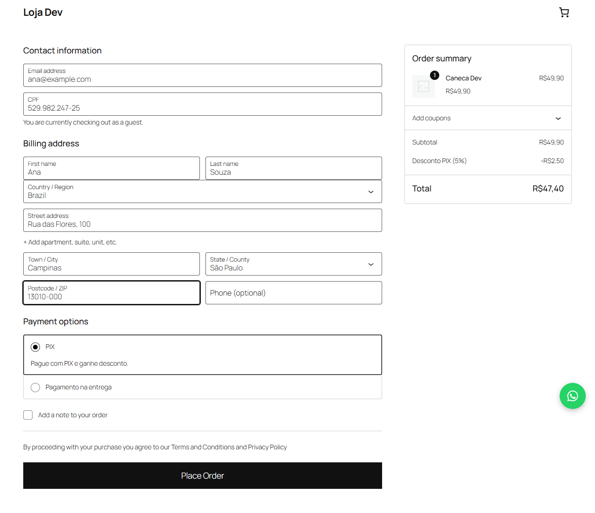
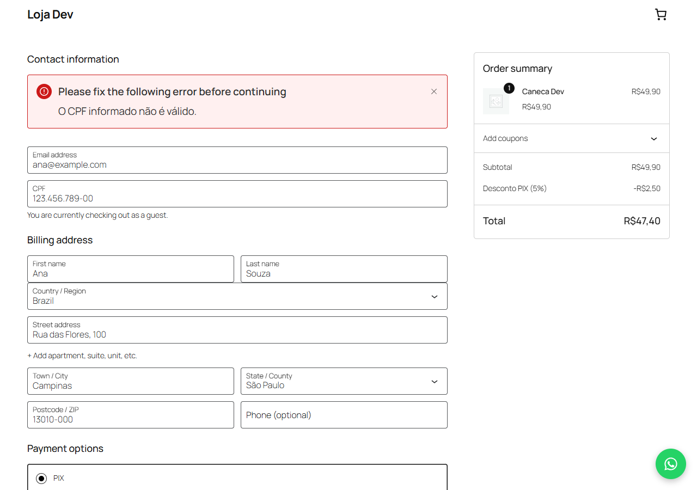
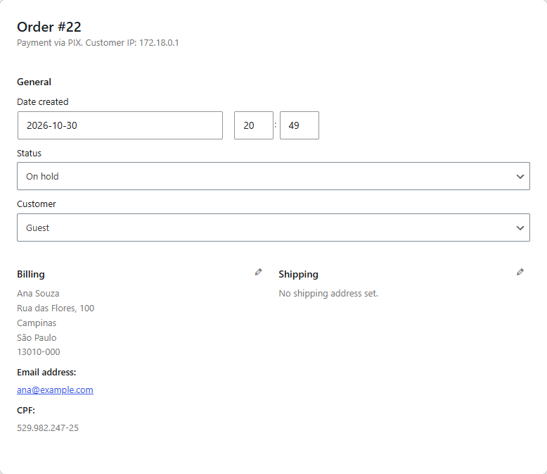
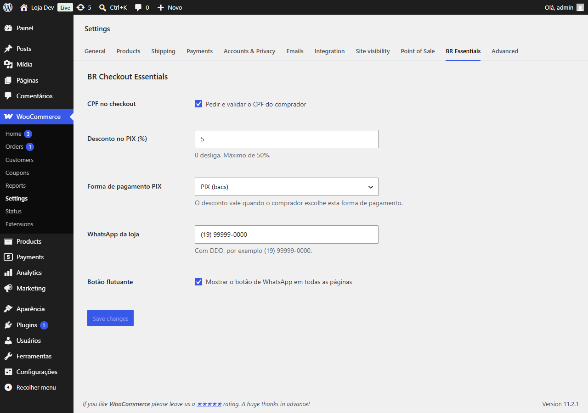

# 04 · WordPress and WooCommerce: BR Checkout Essentials

A WooCommerce plugin that handles three requests Brazilian shop owners make
again and again, with a Docker demo shop to try it on.

| Block checkout, PIX chosen | An invalid CPF refused |
|---|---|
|  |  |
| **The order in the admin, with its CPF** | **The BR Essentials settings tab** |
|  |  |

| Feature | What the buyer sees | What it does underneath |
|---|---|---|
| **CPF at checkout** | A required CPF field, masked as `000.000.000-00` while typing on the classic checkout and formatted that way on save on the block checkout | Validates the check digits on the server, refuses repeated-digit numbers, saves the CPF on the order, and shows it on the admin order screen and in order emails |
| **PIX discount** | `Desconto PIX (5%)` appears in the order summary when PIX is chosen, and goes away when another method is | A negative cart fee on the subtotal, excluding shipping. The percent is capped at 50% so a typo can't give the shop away |
| **WhatsApp button** | A floating button, or `[br_whatsapp]` anywhere | A `wa.me` link with the message already typed in. On a product page, the message names the product and its link |

Everything is set under **WooCommerce > Settings > BR Essentials**:

- the CPF on or off;
- the discount percent;
- which payment method counts as PIX, picked from the shop's own methods;
- the shop's WhatsApp number;
- the floating button.

## Try it

```bash
docker compose up -d --wait
docker compose --profile setup run --rm cli
```

The second command installs WordPress 7.0 and WooCommerce, activates the
plugin, adds three products, relabels bank transfer as "PIX" with 5% off, and
switches on the WhatsApp button. Then open http://localhost:8080 (admin /
admin).

Both checkouts are covered. The **block checkout**, which a fresh WooCommerce
install uses, gets the CPF through WooCommerce's Additional Checkout Fields
API, and the discount follows the payment method through the Store API. The
**classic checkout**, the `[woocommerce_checkout]` shortcode many existing
shops still run, uses its own form hooks. The demo starts on the block
checkout; to try the classic one:

```bash
CHECKOUT=classic docker compose --profile setup run --rm cli
```

On the block checkout the discount is worked out again from the order's own
payment method when the order is placed, so a buyer can't keep it by
reporting PIX and paying another way.

## Tests

```bash
docker run --rm -v "$PWD:/app" -w /app composer:2.8 install
docker run --rm -v "$PWD:/app" -w /app php:8.3-cli vendor/bin/phpunit
```

The 24 PHPUnit tests cover:

- **CPF:** valid and invalid numbers, including a leading zero, a check digit
  of 0, repeated digits, and wrong lengths.
- **Discount:** rounding to centavos, the cap, and never adding money.
- **Phone numbers and WhatsApp links:** normalizing Brazilian and
  international numbers, and URL-encoding the message.

The rules live in `src/Cpf.php`, `src/Discount.php` and `src/WhatsApp.php`,
which don't depend on WordPress, so they run without it.

Checked by hand on the demo shop, WordPress 7.0 with WooCommerce 11.2, on
both checkouts:

- The discount appears with PIX, disappears with payment on delivery, and
  comes back.
- An invalid CPF blocks the order with "O CPF informado não é válido".
- A valid CPF is stored formatted on the order and shows once on the admin
  order screen.
- On the block checkout, an order sent to the Store API as paid on delivery,
  after the cart was told PIX, is charged in full with no discount line.
- The settings tab saves and lists the shop's payment methods.

## Files

| Path | What it holds |
|---|---|
| `plugin/br-checkout-essentials/br-checkout-essentials.php` | Plugin header, HPOS compatibility, bootstrap |
| `plugin/.../src/Plugin.php` | WordPress and WooCommerce hooks |
| `plugin/.../src/Settings.php` | The settings tab |
| `plugin/.../src/Cpf.php`, `Discount.php`, `WhatsApp.php` | The rules, free of WordPress |
| `plugin/.../assets/` | Checkout refresh and CPF mask (`checkout.js`, classic), payment-method updates (`checkout-blocks.js`, block), button styles |
| `tests/` | PHPUnit tests |
| `scripts/setup.sh` | Demo shop setup with WP-CLI |
