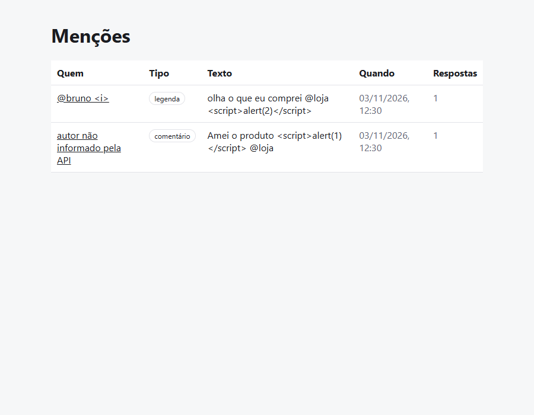
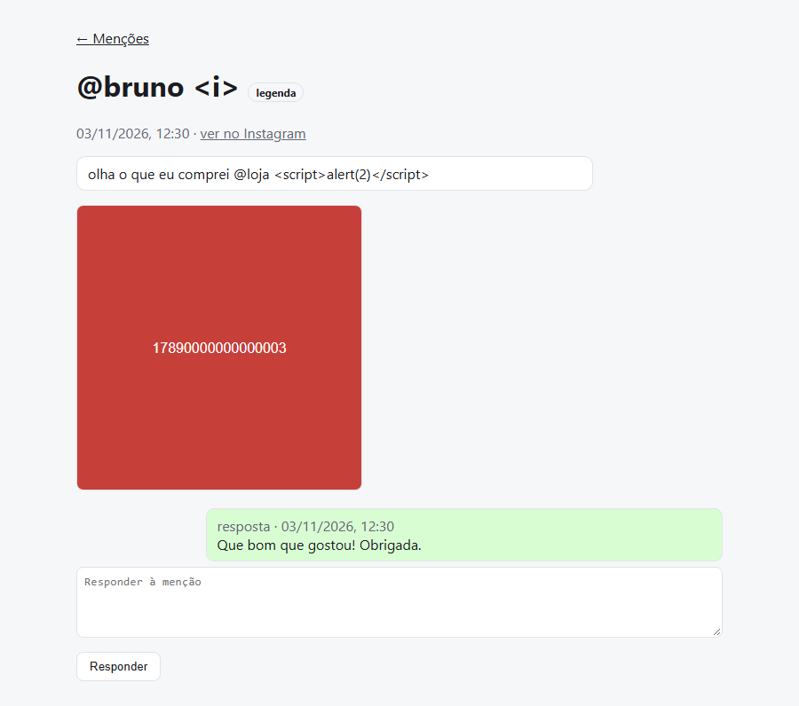

# 05 · Instagram mentions

An app for a business's Instagram account, on the **official Instagram Graph
API**. When someone @mentions the account in a comment or in a post's caption,
Meta sends a webhook; the app fetches the mentioning comment or caption through
the Graph API, stores it, and lists it in a small dashboard where an operator
can reply. It runs two ways: with a real Meta app, or with no Meta app at all,
against a local mock of the Graph API.

| The dashboard | A mention with its reply |
|---|---|
|  |  |

Both screenshots are of the local mock run, not of Instagram: the mentions, the
post image and the "ver no Instagram" link all come from the mock
(`src/mock/graph-mock.ts`). The two mentions carry a `<script>` tag on purpose,
to show it is escaped.

```
Someone ─► @mentions the account ─► Meta ─► POST /webhook ─► check X-Hub-Signature-256
                                                               │ 200 right away, work after
                                                               ▼
                                                  seen this comment / media id?
                                                               │ no
                                                               ▼
                                        GET Graph: mentioned_comment / mentioned_media
                                              │ ok                       │ failed
                                              ▼                          ▼
                                       store the mention       store it with the error
                                              └────────────┬─────────────┘
                                                           ▼
                                      /admin: list, detail, reply ─► POST Graph /mentions
```

## What it gets right

- **Official API only.** It reads and replies through the Graph API with a
  token Meta issues. It does not scrape Instagram or use unofficial libraries.
- **Every webhook is authenticated.** `X-Hub-Signature-256` is checked against
  the app secret on the raw body before any JSON is read.
- **Each mention is stored once.** The webhook is acknowledged at once so Meta
  does not retry, and the mention is keyed by its comment id (or its media id
  for a caption), so a redelivered webhook is stored and fetched once.
- **Meta does not keep webhook data for you,** so the app stores every mention
  itself, in Postgres.
- **The token never goes in a URL.** It is sent in the `Authorization` header,
  so request URLs are safe to log.
- **A failed fetch is not lost.** If Graph refuses or returns nothing, the
  mention is stored with the error and the dashboard shows it as "Não lida".
- **The dashboard is safe to expose.** It uses Basic auth, escapes everything
  people write, renders a permalink or image only when it is an `http(s)` URL
  (no `javascript:` or `data:`), and refuses form posts from other sites.

## Run it

### Without a Meta app (default)

```bash
docker compose up --build
```

Nothing to configure: every value has a local test default.

In this run the Graph API and the webhook sender are a local mock
(`src/mock/graph-mock.ts`), standing in for graph.facebook.com. No Instagram
account or Meta app is involved, nothing reaches Meta, and the screenshots above
are of this mock run, not of Instagram.

Then send some mentions and open the dashboard:

```bash
node scripts/send-test-webhooks.mjs
# or one mention by hand:
curl -X POST localhost:4010/__mock/mentions -H 'content-type: application/json' \
  -d '{"kind":"comment","username":"ana","text":"@loja adorei"}'
```

Open `http://localhost:3000/admin` (`admin` / `local-pw`).

`node scripts/send-test-webhooks.mjs` does the webhook handshake, sends a forged
webhook, emits a comment and a caption mention, delivers one webhook twice,
replies through the dashboard form, and prints what held.

Without Docker, keeping mentions in memory (three terminals):

```bash
npm install
npm run dev:mock          # the Graph mock on :4010, posting webhooks to :3000
INSTAGRAM_VERIFY_TOKEN=local-verify INSTAGRAM_APP_SECRET=mock-app-secret \
INSTAGRAM_ACCESS_TOKEN=mock-token ADMIN_USER=admin ADMIN_PASSWORD=local-pw \
GRAPH_BASE_URL=http://localhost:4010 npm run dev
node scripts/send-test-webhooks.mjs
```

### With a real Meta app (keyed)

1. Have a professional (Business or Creator) Instagram account linked to a
   Facebook Page.
2. Create a Meta developer app with the Instagram product and request the
   permissions `instagram_basic`, `instagram_manage_comments` and
   `pages_read_engagement`.
3. Get a Page or System User access token for that Page.
4. Under Webhooks, pick the `instagram` object, subscribe the `mentions` field,
   and set the callback URL to `https://<tunnel>/webhook` (for example with
   `cloudflared tunnel --url http://localhost:3000`) and the verify token to
   `INSTAGRAM_VERIFY_TOKEN`.
5. Copy `.env.example` to `.env` and fill in `INSTAGRAM_VERIFY_TOKEN`,
   `INSTAGRAM_APP_SECRET` and `INSTAGRAM_ACCESS_TOKEN`, set `ADMIN_PASSWORD`,
   and set `GRAPH_BASE_URL=https://graph.facebook.com`.
6. Start it with `docker compose up app db`. The app lists the mock service
   under `depends_on`, so the mock container starts too, but nothing calls it:
   `docker-compose.yml` passes `GRAPH_BASE_URL` through from your `.env`, so
   the app talks to graph.facebook.com.
7. @mention the account from another Instagram account and open
   `http://localhost:3000/admin`.

The Instagram-Login variant (`graph.instagram.com`) delivers mentions in
`comments` notifications instead. It is not implemented.

Limits Meta documents: mentions in Stories are not supported; there are no
webhooks for media of private accounts; `media_url` is absent for some reels,
which the dashboard shows as a mention without an image.

**Not run against live Meta.** There was no Instagram account or Meta app to
run it with, so the keyed path is untested end to end. These field details come
from Meta's documentation and were not checked against a live response: the
`mentioned_media` fields (`username`, `media_type`, `permalink`, along with the
caption and media URL) and that a caption mention's webhook carries only
`media_id`.

### What is real and what is a stand-in

| Piece | Keyed run | Keyless run |
|---|---|---|
| Graph API | Meta's graph.facebook.com | A local mock in `src/mock` that answers the same fetch and reply endpoints and error shapes |
| The webhook sender | Meta, signing with the app secret | The mock, signing with a local secret |
| The post image and permalink | Instagram's | Pages and an SVG served by the mock |
| Postgres | Real | Real |
| Signature check, dedup, fetch, dashboard, reply | Same code | Same code |

The mock is not Instagram and nothing here proves a reply reaches a real
account.

## Tests

```bash
npm test          # 60 tests
npm run typecheck
npm run build
```

`src/app.test.ts` (20 tests) runs the real Express app on a random port, with
fakes in place of Graph and a memory store. It covers:

- the webhook challenge, right and wrong verify token;
- unsigned and forged webhooks, and a signed body that is not JSON;
- a comment mention and a caption mention fetched and stored;
- a webhook delivered twice, stored and fetched once;
- a webhook field other than `mentions`, ignored;
- a mention Graph could not be read for, kept with the error;
- the dashboard's login, listing, HTML escaping and 404s;
- replies to a comment and to a caption, a reply Instagram refuses kept as not
  delivered, an empty reply, cross-site posts, and links and images only for
  `http(s)` URLs.

`src/instagram.test.ts` (18 tests) covers signature checks, payload parsing,
the mention key, Graph's error message, and `GraphApiClient`: the exact
requests, the token in the header and not the URL, absent `media_url`, encoded
ids, the 2200-character reply limit and a custom base URL.

`src/mock/graph-mock.test.ts` (22 tests) runs the mock behind the real
`GraphApiClient`: its fetch and reply endpoints, refusals, requested fields,
the signed webhooks it emits, its labelled post page and image, and one end to
end run with the real app (a mention stored once, a reply sent through).

`PgStore` and `docker-compose.yml` have no automated test. The Docker stack was
not run for this README; its screenshots and the demo script's output are from a
native run of the app and the mock.

## Files

| Path | What it holds |
|---|---|
| `src/instagram.ts` | Signature check, webhook parsing, mention key, Graph client |
| `src/handler.ts` | What happens to one mention: dedup, fetch, store |
| `src/app.ts` | Webhook routes and the dashboard routes |
| `src/admin.ts` | Dashboard HTML |
| `src/store.ts` | Postgres store and an in-memory one with the same interface |
| `src/main.ts` | Starts the app from environment variables |
| `src/mock/graph-mock.ts` | The local stand-in for the Graph API, with a dev route to emit mentions |
| `src/mock/mock-main.ts` | Starts the mock from environment variables |
| `src/*.test.ts`, `src/mock/*.test.ts` | The tests above |
| `scripts/send-test-webhooks.mjs` | Drives a running stack and prints what held |
| `db/schema.sql` | The table, applied at startup |
| `docker-compose.yml`, `Dockerfile` | App, mock and Postgres; one image serves the app and the mock |
| `.env.example` | The variables, with the local test values |
| `docs/screenshots/` | The two README images, from the mock run |
